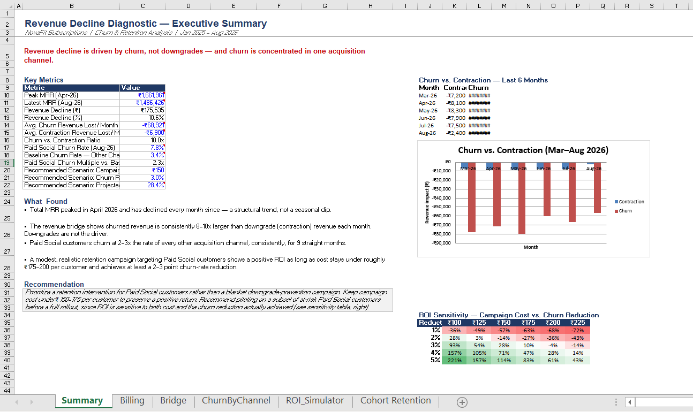
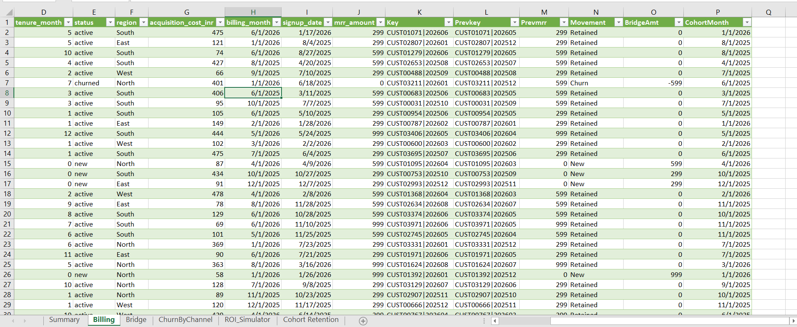

# Revenue Decline Diagnostic — Churn, Cohort & ROI Analysis in Excel

A self-contained Excel case study diagnosing why a subscription business's revenue was
declining despite steady signups — built entirely with Power Query and native Excel
formulas (no Power BI, no DAX), to demonstrate that the underlying analytical thinking
doesn't depend on any one tool.

## Business Problem

> Monthly recurring revenue had been declining for several months despite stable new
> customer signups. Leadership needed to know: is this a churn problem, a downgrade
> problem, or an acquisition-quality problem — and where should limited retention budget
> be spent first?

## Approach

1. **Data cleaning (Power Query)** — imported a deliberately messy raw billing export
   (mixed date formats, inconsistent text casing, missing values, duplicate rows) and
   built a repeatable cleaning pipeline.
2. **Revenue bridge (waterfall)** — decomposed month-over-month MRR change into New,
   Expansion, Contraction, and Churn, reconciled to the cent against total MRR.
3. **Channel drill-down** — cut churned revenue and churn rate by acquisition channel to
   isolate where the problem was concentrated.
4. **Cohort retention analysis** — built retention heatmaps (signup cohort × tenure
   month) comparing the flagged channel against all others, to visually confirm the
   drop-off pattern.
5. **Win-back ROI simulator** — modeled the expected return on a retention campaign
   using a two-variable Data Table (campaign cost × churn-reduction target), to turn the
   diagnosis into a funded recommendation.

## Key Findings

- Churned revenue was **8–10x larger** than downgrade (contraction) revenue every month
  — the decline was a retention problem, not a pricing/plan problem.
- **Paid Social** customers churned at **2.3x** the rate of every other channel combined
  (7.8% vs. 3.4% monthly, as of the most recent month), consistently for 9 straight
  months.
- Cohort retention confirms it structurally: at month 9 post-signup, non-Paid-Social
  customers retain at **62.5%**, versus **25%** for Paid Social customers from the same
  cohort — roughly 2.5x worse.
- A targeted retention campaign for Paid Social customers shows a positive ROI (~28% at
  ₹150/customer cost, 3-point churn reduction), but ROI is highly sensitive to execution
  cost — breakeven sits around a 2-point churn reduction if cost stays under ~₹175–200
  per customer.

## Recommendation

Prioritize a retention intervention specifically for Paid Social customers rather than a
blanket retention campaign. Keep cost under ₹150–175/customer and pilot on a subset
before full rollout, since the business case depends on actually achieving a meaningful
churn-rate reduction, not just running a campaign.

## Tools Used

Excel (Power Query, XLOOKUP, COUNTIFS/SUMIFS, Data Tables, Conditional Formatting). No
Power BI or DAX — deliberately, to show the methodology holds independent of the BI
tool.

## Files

- `NovaFit_Churn_Diagnostic.xlsx` — full workbook (Billing, Bridge, ChurnByChannel,
  CohortRetention, ROI_Simulator, Summary sheets)
- `monthly_billing_activity.csv`, `customers_master.csv` — raw source data (synthetic)

## Screenshots

